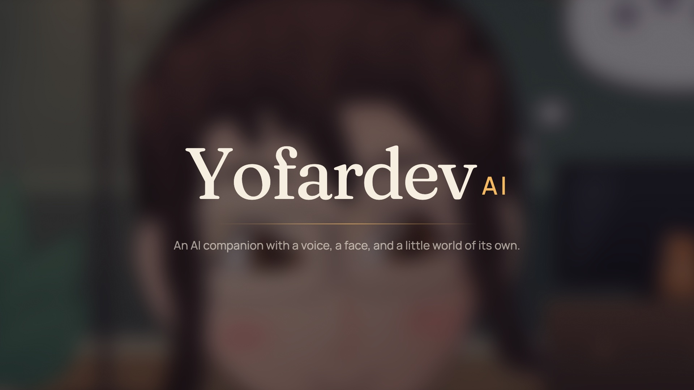
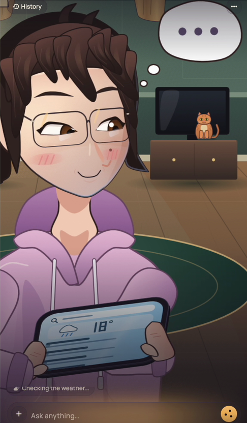
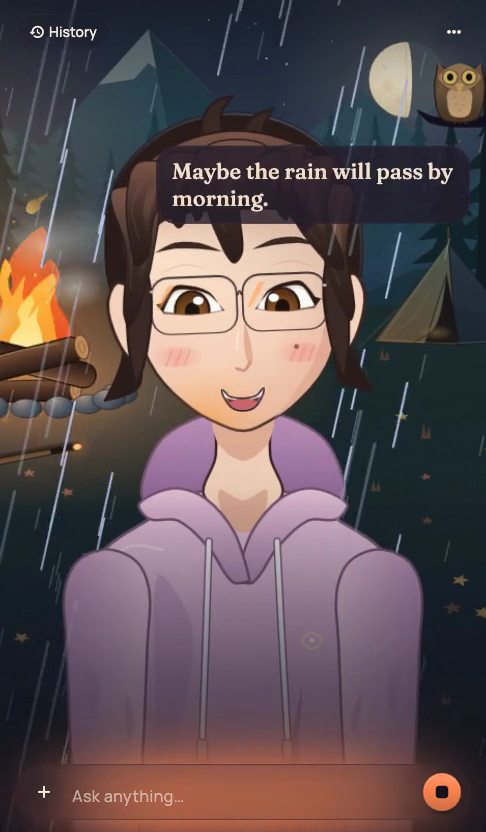
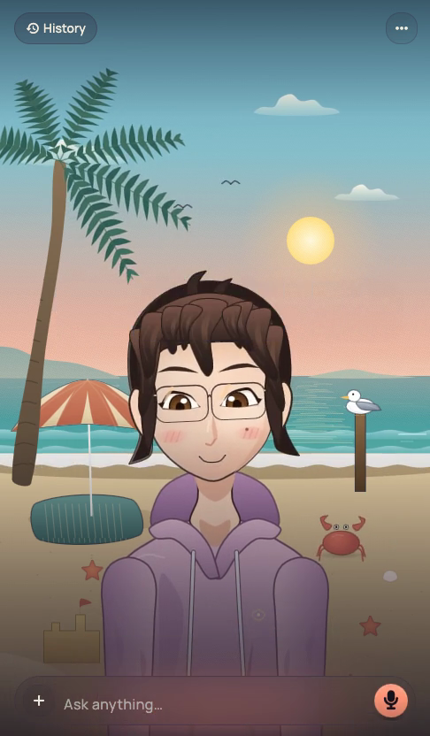

# Yofardev AI

An open-source Flutter app that gives an AI assistant a voice, an expressive Rive avatar, and a world to inhabit. Type a message or use speech input on supported platforms; the assistant streams its reply, speaks it aloud, and acts along with the conversation.

[Android releases](https://github.com/YofarDev/yofardev_ai/releases) · [Web demo](https://yofardev-ai.web.app) (limited features) · [Support on Ko-fi](https://ko-fi.com/yofardev)

Bring your own LLM: connect a cloud or local server through an OpenAI-compatible API. The voice runs on-device; the language model runs wherever your configured endpoint lives.

## A look at the app

<p align="center">
  <a href="film/yofardev-ai-film.mp4"></a>
</p>

<p align="center"><b><a href="film/yofardev-ai-film.mp4">▶ Watch the showcase film</a></b> (2 min): every app frame is a real capture, with the app's own on-device voice and an original score. How it was made: <a href="film/README.md">film/README.md</a>.</p>

<p align="center">
  
  
  
  
</p>

Actual app captures from the Rive rework, recorded on macOS with scripted conversations. See [screenshot sources](screenshots/README.md).

Short recordings: [a story by the fire](rive/review/m12/wow/wow1.mp4) · [a weather lookup](rive/review/m12/wow/wow2.mp4) · [a journey to the beach](rive/review/m12/wow/wow3.mp4). These scripted recordings use a system voice for repeatability; the app's default voice is Kokoro.

## Features

### A character and a living stage

- **Expressive Rive avatar:** facial expressions, blinking, gaze, gestures, and speech-driven lip sync aligned with the sentence text and audio.
- **Ten interactive scenes:** living room, campfire, beach, deep space, café, rooftop, mountain hut, forest cabin, train compartment, and library. Tap props, drag scene controls, and meet the resident wildlife.
- **Animated journeys:** the avatar walks between scenes, with doors, outdoor paths, a rocket, or a portal depending on the destination.
- **A changing world:** time of day, rain, fog, moon phases, seasonal details, and ambient sound. Own-location weather can update the world when configured and permission is already granted.
- **Wardrobe and personality:** hats, tops, glasses, colour variants, costumes, and personas that influence the assistant's replies and body language.

### Conversation and voice

- **Streaming replies and queued speech**, with a stop control to interrupt the assistant.
- **On-device Kokoro TTS** for French and English, after a one-time model download of about 132 MB. Android also has a Supertonic fallback while Kokoro is unavailable.
- **Text or microphone input** on supported platforms, plus image attachments when the selected model supports vision.
- **Live speech captions**, local chat history, generated chat titles, and editable memory carried between conversations.
- **Multiple LLM configurations**, with task-specific choices for the assistant, title generation, function calling, and memory extraction.
- **French and English UI**, scene-aware glass surfaces, screen-reader actions, reduced-motion support, and adaptive rendering quality.

### Tools

The assistant can look up weather, search the web, read web pages, retrieve popular news, calculate, count characters, set alarms where supported, and change its appearance or scene. Tool availability depends on the platform, configured services, and model support for function calling.

## Get started

Install an Android APK from [Releases](https://github.com/YofarDev/yofardev_ai/releases), or build from source below. No API keys are bundled.

1. Open the stage's **More menu → Settings**.
2. In **Task LLM Configuration**, add an LLM configuration with your provider's base URL, model name, and API key (if required), then select it for the assistant. Use an OpenAI-compatible endpoint that supports streaming chat completions and JSON responses; enable a model with tool support to use function calling.
3. Check the voice status in Settings. Kokoro downloads its model in the background on first launch; once installed, speech generation works offline. LLM replies still need access to your chosen server.
4. Optionally open **Function Calling Configuration**, enter credentials for the services you want, and enable them:

   | Service | Configuration |
   | --- | --- |
   | [OpenWeather](https://openweathermap.org/api) | API key for weather |
   | [New York Times](https://developer.nytimes.com/) | API key for popular news |
   | [Google Custom Search](https://developers.google.com/custom-search/v1/overview) | API key and search engine ID for web search |

5. Return to the stage and send a message. The More menu also contains the scene picker and caption toggle.

Chat history, memory, and settings are saved locally. Prompts and attached images are sent to the LLM endpoint you configure; enabled online tools contact their respective services.

## Build from source

You need Flutter with Dart **>=3.8.0 <4.0.0** and the toolchain for your target platform (Android SDK for Android, Xcode for macOS/iOS).

```bash
git clone https://github.com/YofarDev/yofardev_ai.git
cd yofardev_ai
flutter pub get
flutter run
```

To build an Android release APK:

```bash
flutter build apk --release
```

Generated Dart files and Rive assets are committed. After changing annotated models or localization files, regenerate them:

```bash
dart run build_runner build --delete-conflicting-outputs
flutter gen-l10n
```

The bundled `.riv` files are ready to use. To change the vector art or animation, see the [Rive source guide](rive/README.md) and [asset contract](rive/CONTRACT.md); rebuilding them uses `./scripts/frive.sh` and requires the Rive CLI and `uv`.

## Platforms and limitations

| Platform | Status |
| --- | --- |
| Android | Primary target for the full experience. |
| macOS | Used for development and integration captures. Text chat, Rive, and Kokoro are exercised; microphone input is disabled. |
| iOS | Project files are present; not validated end to end. |
| Windows / Linux | Build targets are present; not validated end to end. |
| Web | Limited demo; native voice and other platform-dependent features are not equivalent to the mobile app. |

Model support for structured replies, tools, and images varies by provider. Tool results also depend on external APIs and their availability. On macOS/iOS, Supertonic fallback is disabled because of a native runtime conflict; speech remains text-only if Kokoro is unavailable. Rendering tiers adapt to device load, battery saver, and thermal conditions, so effects may differ between devices.

## Development

The app uses feature-based Clean Architecture under `lib/features/`, with shared services and design components in `lib/core/`. Flutter BLoC/Cubit handles state, Freezed handles models, `Result<T>` represents failures, get_it provides dependencies, and go_router handles navigation. Rive drives the avatar, scenes, and animated UI controls.

Before finishing a change:

```bash
dart fix --apply
dart format .
./scripts/fverify.sh
```

The local quality gate checks formatting, analyzes the app, and runs tests, including the architecture rules. There are no CI workflows. See [AGENTS.md](AGENTS.md) for project conventions and [scripts/README.md](scripts/README.md) for scaffolding, localization, and asset tools.

## Earlier demo

The [original YouTube demo](https://www.youtube.com/watch?v=UXpE2vQsJhY) shows an earlier version, before the Rive avatar and stage rework.

## Support

If you enjoy the app or want to support its development, [buy me a coffee on Ko-fi](https://ko-fi.com/yofardev). Bug reports and contributions are welcome through [GitHub issues](https://github.com/YofarDev/yofardev_ai/issues) and pull requests.

## License

[MIT](LICENSE).
