# M0 spike: Kokoro phoneme timing and lip-sync drift

Questions: (a) can we get per-phoneme timings from Kokoro to drive visemes, and by which
on-device route; (b) how far does today's open-loop amplitude timer
(`TtsPlaybackService.startAmplitudeAnimation`) drift from the real audio position.

**Short answer.** (a) Yes. Kokoro's duration predictor counts **frames of 600 samples at
24 kHz (25 ms)**. The sum of durations equals the audio length **exactly** (0 ms residual
in 11/11 chunks). sherpa's shipped `model.int8.onnx` already outputs these durations as its
second graph output, but sherpa 1.13.8 drops that output. **Route B** (run the same
ONNX file through onnxruntime and do G2P ourselves) is the recommended route. Route A
needs a sherpa fork. Route C is a fallback only. The raw timeline runs **~50 ms (EN) to
~65 ms (FR) behind the audio**, so shift it by -50 ms. (b) Two errors, both open-loop:
- **Start offset.** The timer starts before the audio is audible. The mouth leads the audio
  by **~245–255 ms on macOS** for the whole sentence; on the emulator the offset is
  **0–90 ms**. The cause is start latency L (≈ 270–280 ms on macOS, ≈ 180 ms in emulator
  run 3), and drift ≈ L − interval − timer lateness.
- **Lost ticks.** The stepping keeps its rate only while the UI isolate never stalls for
  more than one interval. Dart's `Timer.periodic` drops missed periods without calling the
  callback, and the app counts callbacks (`currentIndex++`), so **each stall permanently
  loses whole ticks**. An induced 300 ms stall shifted drift by -300 ms on macOS (12 ticks
  lost) and by -169 ms on the emulator (2 ticks lost). It never recovered, while the audio
  played on.

Tools (all on the spike branch):
- `scripts/spikes/kokoro_timing.py`: text to `audio.wav` + `timeline.json`, with the sum check.
- `scripts/spikes/timeline_overlay.py`: waveform PNG overlay, bilabial dip score, lag estimate.
- `scripts/spikes/inspect_onnx_outputs.py`: ONNX graph inputs/outputs/metadata.
- `scripts/spikes/onnx_durations_check.py`: int8 ONNX durations compared with PyTorch.
- `integration_test/spikes/lipsync_drift_test.dart`: drift measurement (via `test_driver/spike_driver.dart`).

Data: `phoneme-timing/data/` (sum checks, bilabial report, drift JSON per run; run 3 and the stall runs carry
the full per-tick series).

## 1. Offline timings (kokoro 0.9.4, PyTorch)

Setup: `uv run --python 3.12 --with kokoro --with soundfile --with 'misaki[en]'`, which
gives kokoro **0.9.4** and weights from `hexgrad/Kokoro-82M`. Voices: `af_heart` (lang `a`)
and `ff_siwis` (lang `f`, espeak-ng `fr-fr` via misaki).

Where `pred_dur` lives: `KPipeline.__call__` yields `KPipeline.Result`, and
`Result.pred_dur` is a property returning `Result.output.pred_dur`. That is the
`KModel.Output.pred_dur` LongTensor computed in `KModel.forward_with_tokens`:
`round(sigmoid(duration_proj(lstm(...))).sum(-1) / speed).clamp(min=1)`. It has one integer per
input id. The input ids are `[0, *[vocab[p] for p in phonemes if p in vocab], 0]`.

**Boundary tokens.** `pred_dur[0]` and `pred_dur[-1]` belong to the pad id 0, so the
timeline keeps them as `<bos>` (leading silence, 325–500 ms here) and `<eos>` (25 ms).
That way the timeline tiles the whole file. Phoneme characters missing from the vocab
are dropped exactly as the model drops them. The script asserts
`len(tokens) + 2 == len(pred_dur)`. Multi-chunk text (the pipeline yields one Result per
chunk) is handled by summing each chunk on its own and concatenating with offsets.
`--pad-to` appends a `<pad>` entry.

**Unit check** (`abs(sum(durations_s) - len(audio)/24000) <= 0.025`, with a 25 ms frame):

| sentence | lang | tokens | frames | audio | samples / frame | residual |
|---|---|---|---|---|---|---|
| en1 "Peter picked a bunch of purple plums by the big brown barn." | en | 64 | 154 | 3.850 s | 600.0 | 0.0 ms |
| en2 "My mom made pumpkin bread, but Bob baked the best pie." | en | 61 | 150 | 3.750 s | 600.0 | 0.0 ms |
| en3 "Please bring me the map before the boat leaves the harbor." | en | 58 | 132 | 3.300 s | 600.0 | 0.0 ms |
| fr1 "Papa mange une pomme bien mûre au bord de la plage." | fr | 53 | 136 | 3.400 s | 600.0 | 0.0 ms |
| fr2 "Mon ami Paul porte un beau manteau bleu marine." | fr | 49 | 125 | 3.125 s | 600.0 | 0.0 ms |
| fr3 "Le bébé boit du lait puis s'endort sur mon épaule." | fr | 51 | 130 | 3.250 s | 600.0 | 0.0 ms |
| drift20 (5 EN chunks: en1 + en2 + en3 + 2 more) | en | 5 chunks | 733 | 18.325 s | 600.0 each | 0.0 ms per chunk and total |

The audio length is exactly `sum(pred_dur) × 600` samples, because the decoder upsamples
by a fixed hop. **Unit: 1 frame = 600 samples = 25 ms (40 frames/s).** Every duration is
a multiple of 25 ms.

Timeline gotchas for a viseme mapper:
- Stress marks (`ˈ` `ˌ`), the length mark `ː`, the nasal combining tilde (U+0303), spaces
  and punctuation are tokens with their own durations, often 25–75 ms. Fold stress and
  diacritics into the next or previous phoneme, and treat spaces and punctuation as rest
  or closure.
- Durations are quantised to 25 ms, which is coarser than a 60 Hz frame.

## 2. Timeline vs waveform

Overlays: grey = waveform, blue = RMS envelope (20 ms window, 5 ms hop), pink = p/b/m
spans, red labels = bilabials. Labels use the macOS system font Arial Unicode, because the bundled Fraunces and Manrope lack most IPA glyphs (only `ᵊ` still renders as a box).

| sentence | raw timeline | timeline shifted -50 ms |
|---|---|---|
| en1 | 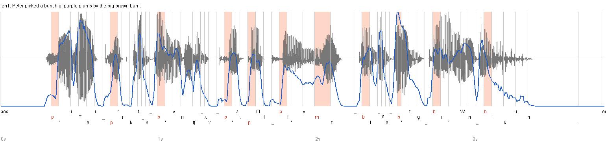 | 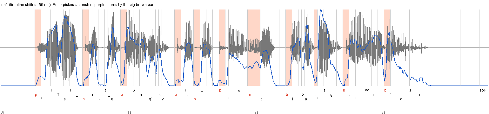 |
| en2 | 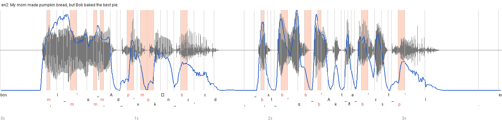 | 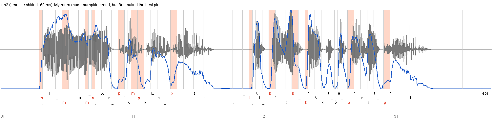 |
| en3 | 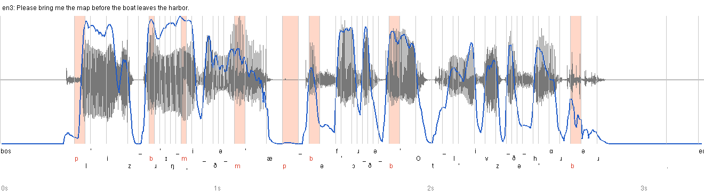 | 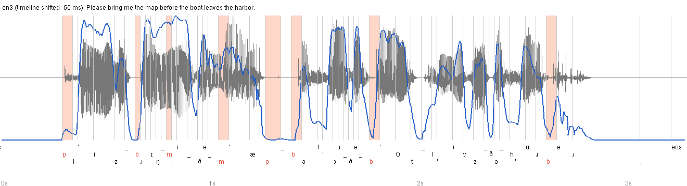 |
| fr1 | 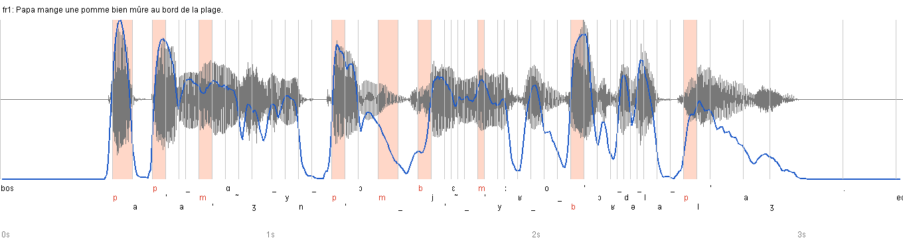 | 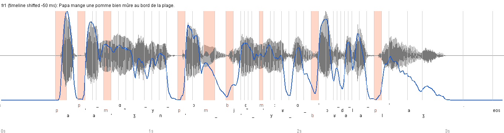 |
| fr2 | 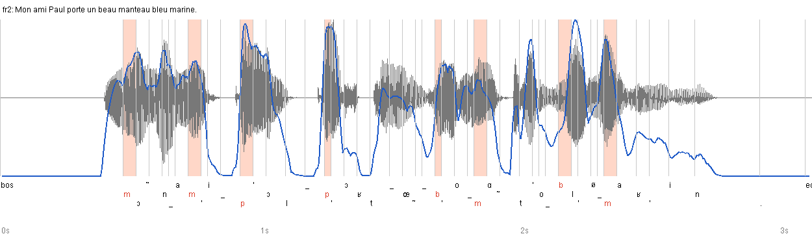 | 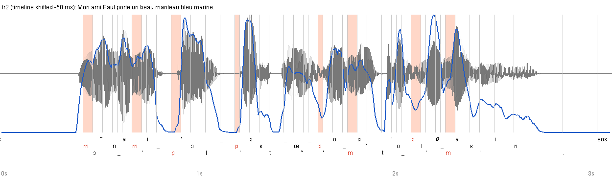 |
| fr3 | 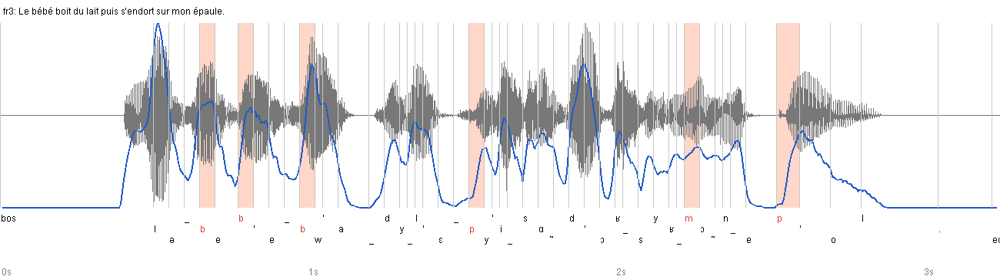 | 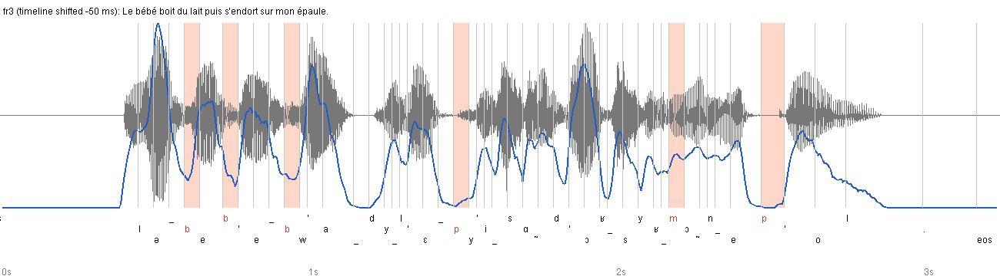 |

**By eye.** On the raw timeline the plosive spans (p, b) sit on the **burst and the start
of the next vowel**. The closure silence lands in the token before them. It is clearest
in fr1 "papa": the second `p` span covers the energy peak, while the silent closure is
labelled as the first `a`. In other words, the timeline is late.

**Lag.** I cross-correlated "expected openness" (vowels 1; bilabials, pads and
punctuation 0; others 0.5) with the RMS envelope over ±200 ms. The best lag is -50, -45
and -50 ms for EN and -70, -60 and -65 ms for FR, so the audio leads the
cumulative-duration timeline by 2–3 frames. kokoro itself applies the same correction:
`KPipeline.join_timestamps` starts words at `pred_dur[0] - 3` frames (-75 ms), next to the
comment `# TODO: Is -3 an appropriate offset?`.

**Bilabial dip score** (`timeline_overlay.py`). *local min* = a local RMS minimum inside
the span. *deep dip* = that minimum is ≤ 50 % of the envelope peak within ±75 ms.
*±25* = deep dip with the span widened by one frame. Open vowels scored the same way are
the false-positive control (lower is better).

| lang | shift | bilabial local min | bilabial deep dip | bilabial deep ±25 | open-vowel deep dip (control) |
|---|---|---|---|---|---|
| en | 0 ms (raw) | 23/33 | 11/33 (33 %) | 17/33 | 6/18 (33 %) |
| en | -25 ms | 18/33 | 11/33 | 26/33 | 6/18 |
| en | **-50 ms** | 28/33 | **23/33 (70 %)** | 27/33 | **3/18 (17 %)** |
| en | -75 ms | 26/33 | 21/33 | 26/33 | 5/18 |
| fr | 0 ms (raw) | 13/23 | 3/23 (13 %) | 8/23 | 13/23 (57 %) |
| fr | -25 ms | 15/23 | 8/23 | 15/23 | 10/23 |
| fr | **-50 ms** | 19/23 | **15/23 (65 %)** | 18/23 | **6/23 (26 %)** |
| fr | -75 ms | 20/23 | 16/23 | 19/23 | 2/23 |

"Contains a local RMS minimum" alone does not discriminate: vowels score 11/18 and 19/23
on it too. On the raw timeline, FR bilabials sit on dips *less* often than open vowels do.
**Verdict: the durations are right in sum and in rhythm, but they must be shifted by about
-50 ms (EN) to -65 ms (FR) before driving visemes.** With that shift, about two thirds of
bilabials land on a clear amplitude dip. The misses are mostly word-final or
nasal-coarticulated `m` (nasals keep voicing energy), plus a few 25 ms spans the 20 ms
envelope cannot resolve.

## 3. On-device route

`kokoro-int8-multi-lang-v1_0.tar.bz2` (126.2 MB) was downloaded into
`build/spikes/downloads/` (git-ignored) and inspected with
`inspect_onnx_outputs.py model.int8.onnx`:

```
inputs:  tokens: INT64[1, sequence_length]   style: FLOAT[1, 256]   speed: FLOAT[1]
outputs: audio: FLOAT[audio_length]
         onnx::Shape_3411: INT64[Squeezeonnx::Shape_3411_dim_0]
metadata: model_type=kokoro, version=2, sample_rate=24000, has_espeak=1, n_speakers=54, ...
          id2speaker=...3->af_heart,...  (producer onnx.quantize 0.1.0, opset 14 + com.microsoft 1)
```

The second, unnamed output is the per-token duration tensor. It is
`KModelForONNX.forward` → `(waveform, duration)` in kokoro's `model.py`.
`onnx_durations_check.py` fed the PyTorch phoneme strings to the int8 graph with the same
style row (`voices.bin[sid][len(phonemes) - 1]`) on all 6 sentences:

| sentence | sid | durations = tokens | exact vs PyTorch | max \|diff\| | sum × 600 = audio samples |
|---|---|---|---|---|---|
| en1 | 3 | 64 = 64 | 63/64 | 1 frame | 93000 = 93000 |
| en2 | 3 | 61 = 61 | 61/61 | 0 | 90000 = 90000 |
| en3 | 3 | 58 = 58 | 54/58 | 1 frame | 78000 = 78000 |
| fr1 | 30 | 53 = 53 | 51/53 | 1 frame | 82800 = 82800 |
| fr2 | 30 | 49 = 49 | 44/49 | 1 frame | 73200 = 73200 |
| fr3 | 30 | 51 = 51 | 49/51 | 1 frame | 76800 = 76800 |

The ±1-frame differences come from int8 quantisation. The int8 model is self-consistent:
its own durations sum exactly to its own audio length.

What sherpa-onnx **v1.13.8** does with it (source read at the tag):
`OfflineTtsKokoroModel::Run` runs every output and then returns `out[0]` only
(`offline-tts-kokoro-model.cc:102`). `GeneratedAudio` is `{samples, sample_rate}`, and the
C API `SherpaOnnxGeneratedAudio` is `{samples, n, sample_rate}`. Neither tokens nor
durations come back. Sherpa also post-processes the audio with
`GeneratedAudio::ScaleSilence(silence_scale)`, which is **0.2 by default**: every pause
longer than 0.2 s with |x| ≤ 0.01 is shortened to 20 % of its length. That edit would
desync any duration timeline unless `silenceScale = 1.0` is passed, or the edit is
replayed on the timeline.

| route | works? | evidence | estimated work |
|---|---|---|---|
| **A**: sherpa's model already exposes durations | **Model yes, sherpa no.** Not usable as shipped. | Output 2 `onnx::Shape_3411` = durations (table above). sherpa 1.13.8 discards it (`return std::move(out[0])`), and the C/Dart APIs have no field for it. ScaleSilence also rewrites pauses. | Fork sherpa-onnx 1.13.8: keep `out[1]` plus the token ids per sentence batch, carry them through `GeneratedAudio`, the C API and the Dart FFI, and remap them through ScaleSilence (or force 1.0). Then build and ship native libs (android arm64/armv7/x86_64, macOS, iOS) and fork the `sherpa_onnx_*` platform packages. **~4–6 dev-days.** Maintenance is small because 1.13.8 is a frozen pin, but we would own native builds. |
| **B**: custom ONNX with durations, run through onnxruntime directly | **Yes. No re-export needed.** | The shipped `model.int8.onnx` already has the durations output. Running it through onnxruntime with `tokens.txt` ids, the `voices.bin` style row and `speed` gives audio and durations from one call (6/6 sentences, sum exact). A re-export with a named output is optional cosmetics (~0.5 day; `KModelForONNX` already returns both). | onnxruntime in Flutter (e.g. a `flutter_onnxruntime`-style plugin) on Android and macOS: 1–2 days. **On-device G2P is the real cost: 3–5 days.** FR = espeak-ng IPA: `espeak-ng -v fr-fr --ipa` output for fr1 equals misaki's string once espeak's `-` markers are stripped. EN = `lexicon-us-en.txt` lookup (178k words, word → space-separated tokens) plus espeak fallback and text normalisation. espeak-ng needs an FFI build, and it is GPL-3: licensing review. Parity tests against sherpa audio: 1 day. **~5–8 dev-days.** This is also where sherpa 2.x already pushes us: 2.0 dropped espeak and requires callers to pre-phonemize. |
| **C**: forced alignment fallback | Plausible, not tried. | Concrete options: **Rhubarb Lip Sync** (MIT, C++/PocketSphinx). It outputs mouth shapes A–H with times from audio plus optional transcript. Its English recogniser does not cover French, so FR would use its language-independent "phonetic" mode, which is weaker. Or an **ONNX CTC phoneme model** (wav2vec2 `xlsr-53-espeak-cv-ft`, ~300 M params, ~300 MB int8) with Viterbi forced alignment against the known phoneme string. | Rhubarb: native build plus FFI, 3–5 days, mid quality and adds analysis latency per sentence. CTC aligner: 5–8 days, ~300 MB extra download, and likely slower than real time on low-end CPUs. **Fallback only.** It throws away the exact durations the TTS model already computed. |

**Verdict: Route B.** Same model file, one inference, exact durations; the work is G2P.
Route A (fork) is the cheapest way to stay on sherpa 1.13.8 if G2P is out of scope.

## 4. Drift of the open-loop amplitude timer

Harness: `integration_test/spikes/lipsync_drift_test.dart`, profile mode,
`assets/rive/spikes/drift_20s.wav`. That file is drift20 from step 1: 18.325 s of
`af_heart` speech padded with silence to exactly 20.000 s, 24 kHz 16-bit mono. The test
mirrors the app path:
- amplitudes come from the app's own `AudioAnalyzer().getAmplitudes(path)`;
- then `setSource(DeviceFileSource)`, `resume()` and `getDuration()`, as in `AudioPlayerService.play`;
- then the exact stepping of `startAmplitudeAnimation`:
  `interval = (durationMs / frames).round().clamp(5, 100)`, `Timer.periodic`, and
  `amplitudes[currentIndex++]` per tick.

Each tick records `drift = currentIndex × interval − await player.getCurrentPosition()`
in ms. **Positive means the mouth is ahead of the audio.**

**Frame count.** The analyzer's frame rate depends on the platform, which I checked in
`audio_analyzer` 0.1.2:
- macOS (Swift) computes RMS over windows of `sampleRate / 40`, giving **800 frames,
  25 ms interval**.
- Android passes `samplesPerSecond` (40) but the Kotlin side ignores it. It calls
  `Amplituda.processAudio(path)` with default compression, which gives **235 frames for
  20 s (~11.75/s, ≈2048 samples per frame), 85 ms interval**. Android mouth updates are
  3.4× coarser than macOS.

**Volume.** On macOS the position advances at volume 0 in every run, so the runs used
volume 0. On the emulator the cold first probe in run 1 stayed at position 0 after
1.5 s, so run 1 fell back to volume 0.05. Runs 2 and 3 advanced at volume 0 and used it.

| tier (renderer) | run | frames / interval | drift mean | drift p50 | drift min..max | \|drift\| max | final | audio ends after animation | timer lateness mean / max |
|---|---|---|---|---|---|---|---|---|---|
| macos (skia) | 1 | 800 / 25 ms | 253.3 ms | 255 | 0..257 | 257 | 255 | 291 ms | 2.3 / 21 ms |
| macos (skia) | 2 | 800 / 25 ms | 241.3 ms | 243 | 0..245 | 245 | 243 | 278 ms | 3.2 / 22 ms |
| macos (skia) | 3 | 800 / 25 ms | 242.0 ms | 244 | 0..245 | 245 | 244 | 279 ms | 2.1 / 9 ms |
| emu (impeller) | 1 | 235 / 85 ms | 33.5 ms | 41 | -178..53 | 178 | 36 | 91 ms | 128 / 249 ms |
| emu (impeller) | 2 | 235 / 85 ms | -4.4 ms | -12 | -146..63 | 146 | -12 | 40 ms | 120 / 246 ms |
| emu (impeller) | 3 | 235 / 85 ms | 84.1 ms | 86 | 0..88 | 88 | 81 | 127 ms | 11.9 / 49 ms |

Emulator = `emulator-5554`, API 37, Impeller/OpenGLES confirmed in logcat. It is **not
throttled**, and its numbers say nothing about any physical device tier.

**Harness revisions.** Runs 1–2 (both tiers) come from an earlier harness that did not
record `timer.tick` or `coalesced_ticks`; their JSON keeps the summary only. Run 3 and the
stall runs record both, and drop the post-completion `pos = 0` tick (the player resets to 0
after completing; one emulator tick landed there in the first stall run).

**Start latency L** is the median `wall − position` from timer start once audio runs (the
timer starts 10–22 ms after the `resume()` call). Drift ≈ L − interval − timer lateness.

| tier | run | L (wall − pos, p50) | interval | timer lateness p50 | L − interval − lateness | measured drift p50 |
|---|---|---|---|---|---|---|
| macos | 1 | 282 ms | 25 | 2 | 255 | 255 |
| macos | 2 | 271 ms | 25 | 3 | 243 | 243 |
| macos | 3 | 271 ms | 25 | 2 | 244 | 244 |
| emu | 1 | 300 ms (98 at start, 296 at end) | 85 | 174 | 41 | 41 |
| emu | 2 | 243 ms (110 at start, 246 at end) | 85 | 172 | -14 | -12 |
| emu | 3 | 182 ms (141 at start, 181 at end) | 85 | 11 | 86 | 86 |

On macOS L is constant over the whole 20 s. On the emulator L itself grows during a run,
so the emulator's audio clock also loses time against wall clock.

**Induced isolate stall** (`--dart-define=SPIKE_STALL_MS=300`: a 300 ms busy-wait on the UI
isolate 8 s after the timer starts; the normal run is unchanged without it):

| tier | coalesced periods (`timer.tick − callbacks`) before → after | drift before stall (mean) | drift > 1 s after stall (mean, min..max) | final | animation ends vs audio end | timer lateness p50 |
|---|---|---|---|---|---|---|
| macos (skia) | 0 → **12** | +238.9 ms | **-56.9 ms** (-60..-25) | -25 ms | 22 ms *after* audio (was 280 ms before) | 325 ms (13 × 25) |
| emu (impeller) | 0 → **2** | +22.5 ms | **-146.4 ms** (-151..-145) | -147 ms | 113 ms *after* audio | 171 ms (2 × 85) |

The first emulator stall run gave the same picture: +14.6 → -153 ms, 2 periods lost
(`drift_emu_stall300_runA.json`). The callback after the stall fires once, `timer.tick`
jumps past the missed periods, and the app's `currentIndex` never catches up. The audio
keeps playing through the stall (`pos` advanced 8033 ms at wall 8326 ms on macOS), so the
mouth ends up **permanently behind by the stall length, rounded down to whole intervals**.
On macOS the 300 ms stall happened to cancel most of the ~245 ms lead. That is a
coincidence: a second stall would push the mouth a further ~300 ms behind.

This also explains emulator runs 1–2. Their timer lateness p50 of 172–174 ms is about
2 × 85, the same signature as the induced stall with 2 lost periods. Coalescing was not
recorded there, so this is inferred. On the emulator the net drift stayed small only
because its audio clock stalled by a similar amount (L grew ~200 ms). On a device the
audio thread keeps playing through UI-isolate jank, as it did in the induced stall, so the
mouth falls behind and stays behind.

**Reading it.**
- **macOS without stalls: a constant start offset.** The reported position stays at 0 for
  ~250–280 ms after `resume()` returns: 10 ticks of `pos_ms = 0`, then the first non-zero
  position at wall ≈ 278–302 ms. From then on the drift is flat: the run-1 mean is
  254.9 ms over ticks 20–60, 255.2 ms over ticks 380–420 and 255.2 ms over ticks 760–800.
  Without isolate stalls, Dart's `Timer.periodic` holds its schedule (lateness 2–3 ms,
  not accumulating; 0 coalesced ticks recorded in run 3), and the audio clock runs at wall
  rate. The mouth leads the sound by
  about 1/4 s for the whole sentence. `onPlayerComplete` arrives ~280–290 ms after the
  animation ends, which confirms the position reading.
- **Emulator: the start offset is small (0–90 ms) but noisy.** In runs 1–2 the timer fell
  ~175 ms (about 2 periods) behind wall clock part-way through. Lost ticks are the likely
  cause (see the stall runs above). The audio clock fell behind by a similar amount
  (`pos − wall` went from about -140 to about -250 or -300 ms), so the net drift moved only
  briefly, with transients of -146 and -178 ms during the stalls. Run 3 had no stall and
  sat flat at about +85 ms, roughly one tick. That is host scheduling noise, not a model of
  any device.
- **getCurrentPosition latency and granularity.**
  - macOS: query round trip mean 0.3 ms (max 2). After start-up the position is
    effectively continuous: 791 distinct values in 800 samples, steps p50 25 ms equal to
    the tick spacing, min 6–7 ms. The drift is therefore not a position-reporting step
    artefact.
  - Emulator: query round trip mean 2–5 ms (max 56). Every sample is distinct, so
    granularity is below the 85 ms sampling. The reported position is **not monotonic**:
    run 1 jumped back 76 ms (6495 → 6419 ms) after a stall. A closed-loop driver must
    smooth or clamp it.

**Implications.** The open-loop stepping is rate-accurate only while the UI isolate never
stalls for more than one interval; each stall permanently loses whole ticks. The other
errors are the playback start latency, which the timer never sees, and coarse 85 ms frames
on Android. Starting the timer on the first `pos > 0` removes only the start offset. To
fix the offset and the lost ticks together, derive the frame from the clock instead of
counting callbacks: use `getCurrentPosition()` / `onPositionChanged` each frame, or at least
`timer.tick` with a start-latency correction. A phoneme timeline (section 3) would be
indexed the same way.

## Limits

- Bilabial scoring is a heuristic on an RMS envelope: 56 bilabials, 41 open vowels, and a
  single voice per language. The lag estimate uses a crude openness model. Both are
  evidence for a constant offset, not a calibrated viseme accuracy number.
- The ONNX check feeds PyTorch/misaki phoneme strings. sherpa's own G2P (lexicon for EN,
  espeak for FR) can produce different tokens, for example misaki's `T`/`ᵊ`/`I`/`W` symbols
  against the lexicon's `ɾ`/`ə`. Route B must define its G2P and test parity against the
  audio sherpa ships today.
- Drift is measured against the player's *reported* position. The extra acoustic output
  latency (AudioTrack/CoreAudio buffers to the speaker) is not measured; that needs a
  loopback recording. Three runs per tier, plus one induced-stall run per tier (two on the
  emulator).
- Android numbers come from the emulator only (Amplituda frame count, offsets). No physical
  device was run.
