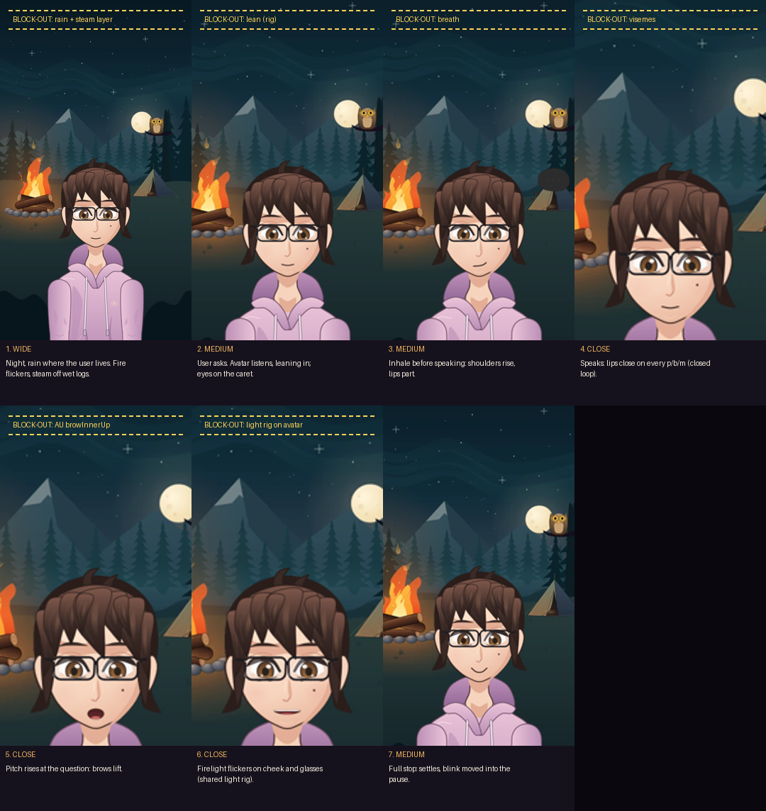
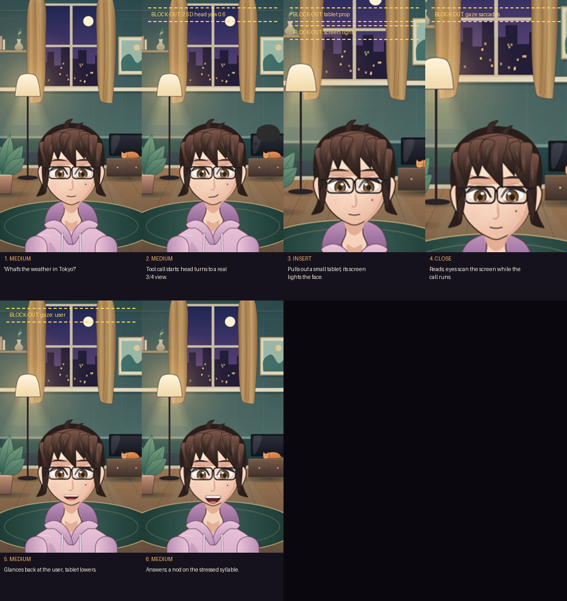
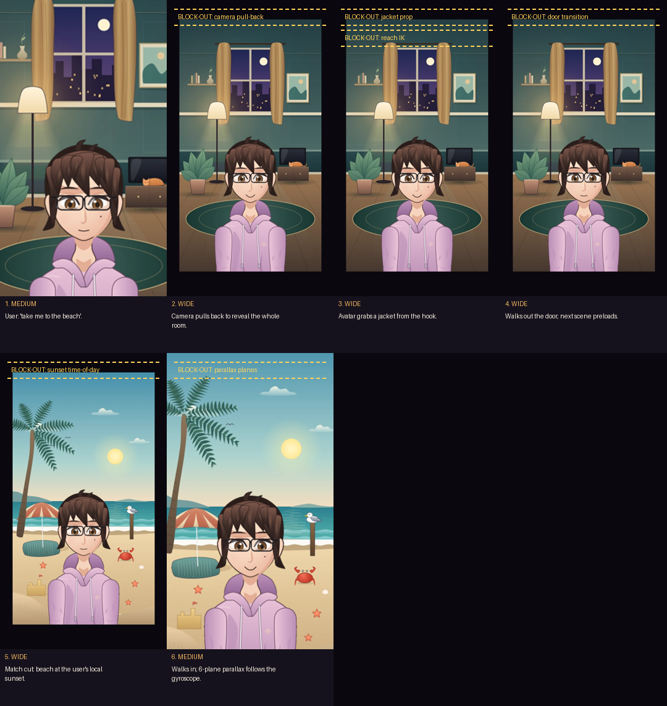

# Wow-moment storyboards (M1, for owner sign-off)

These are rendered by `uv run --with pillow rive/tools/storyboard.py docs/superpowers/storyboards/2026-10-m1`.
Each frame is today's real scene poster plus a headless capture of the real avatar. Yellow
dashed boxes are **block-outs**: things the moonshot still has to build. The sheets show how far
today's assets are from each moment. The look itself is set in the [art bible](../../../../rive/ART_BIBLE.md).

## Wow 1: campfire at night, raining where the user lives

| # | shot | beat | timing | needs |
|---|---|---|---|---|
| 1 | wide | Rain matches the user's local weather. Steam rises off the wet logs. | 3 s establishing | world sync (M7–M9), rain/steam FX |
| 2 | medium | The avatar leans in to listen, eyes on the composer caret. | while the user types | listening lean and caret gaze (M4–M6) |
| 3 | medium | Inhale before speaking: shoulders rise, lips part. | 350 ms before audio | breath layer |
| 4 | close | Lips close on every p/b/m. | sentence | visemes on the closed-loop clock (**M1 lands the clock**) |
| 5 | close | Brows lift on the question's rising pitch. | pitch peak | prosody → AU browInnerUp |
| 6 | close | Firelight flickers on the cheek and glasses. | continuous | shared light rig (M4–M6) |
| 7 | medium | Settles at the full stop. The blink moves into the pause. | 220 ms settle | motion rules |

## Wow 2: "What's the weather in Tokyo?"

| # | shot | beat | timing | needs |
|---|---|---|---|---|
| 1 | medium | The user asks. | — | today |
| 2 | medium | The tool call starts, and the head turns to a real 3/4 view. | 300 ms turn, gaze leads by 40 ms | 2.5D head ≥ 8.5 (M1 gate) |
| 3 | insert | The avatar pulls out a tablet; its screen lights the face. | while the tool runs | tablet prop, screen light |
| 4 | close | Eyes scan the screen. | while the tool runs | gaze saccades |
| 5 | medium | It glances back at the user and lowers the tablet. | tool done | gaze `user`, `PerformanceDirector` tool state (**M1**) |
| 6 | medium | It answers, nodding on the stressed syllable. | sentence | auto-acting nod (**M1**), prosody |

## Wow 3: changing scene is a journey

| # | shot | beat | timing | needs |
|---|---|---|---|---|
| 1 | medium | The user asks to go to the beach. | — | today |
| 2 | wide | The camera pulls back. | 600 ms | camera director (M7–M9) |
| 3 | wide | The avatar grabs a jacket from the hook. | 700 ms | jacket prop, reach IK |
| 4 | wide | It walks out the door while the next scene preloads. | 1.2 s | door transition, preload |
| 5 | wide | Match cut to the beach at the user's local sunset. | cut | time of day |
| 6 | medium | It walks in, with 6-plane gyroscope parallax. | 1 s | parallax planes (M4–M6) |

## Sign-off

- [ ] Owner approves the three storyboards (or lists changes).
